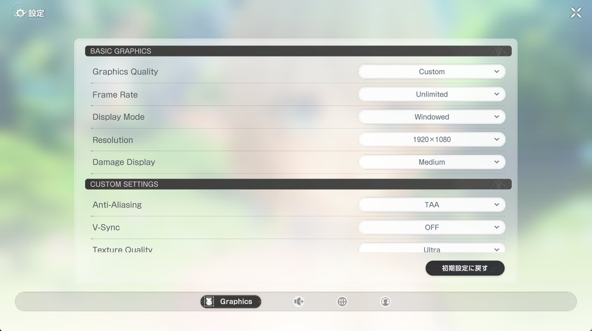
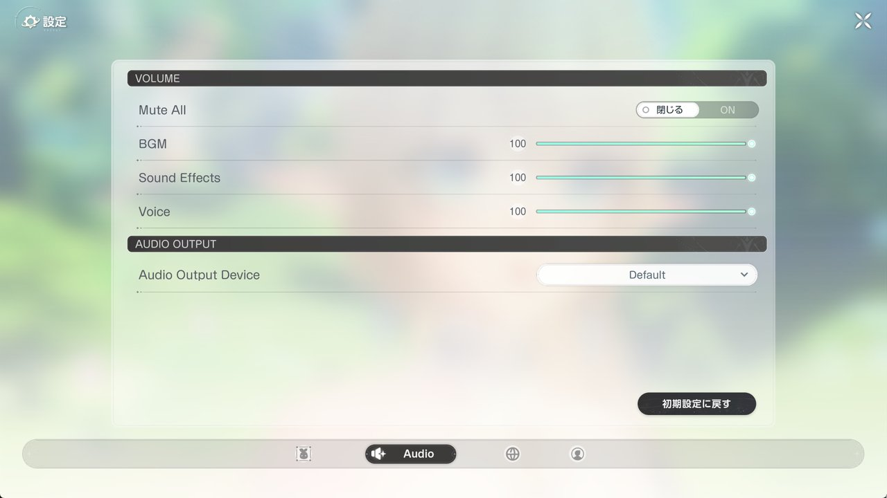
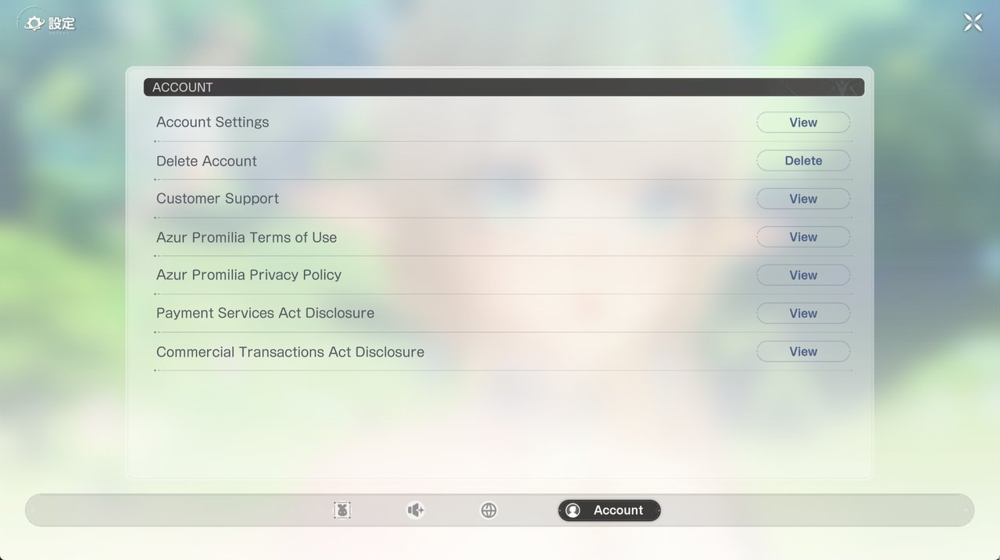

# Azur Promilia English Fan Patch

> [!WARNING]
> Use at your own risk. We are not responsible for any action taken against your account as a result of using this translation tool.

An unofficial English translation of the in-game text for **Azur Promilia (Japanese PC version)**: story dialogue, choices, quests, items, menus and settings. Voice audio, images and the launcher are not changed.

This project is not affiliated with or endorsed by the developers or publishers of Azur Promilia.

> [!NOTE]
> Testing so far covers only the login screen, the main menus and the settings. Story, quests and other in-game text have not been checked in game yet, so expect rough or untested translations there. Screenshots of lines that read badly are welcome in [Issues](../../issues).

## Screenshots

| Graphics | Audio | Account |
|:---:|:---:|:---:|
|  |  |  |

## Requirements

- Windows PC version of Azur Promilia (Japanese client)
- The game version the patch was made for. Each release lists it, and the patcher checks it before changing anything.

## Install

1. Download `AP-English-Patcher-vX.Y.zip` from [Releases](../../releases) and extract it.
2. Close the game.
3. Run `AP-English-Patcher.exe`. It finds the game folder automatically, or click **Browse...** and select the folder that contains `AzurPromiliaJP.exe`.
4. Click **Install English Patch**.

To go back to the original Japanese text, run the patcher again and click **Restore Japanese**.

## When the game updates

A game update replaces the patched files with new Japanese ones, and the patcher will report a different game version. Wait for a new release that supports the new version.

If the patcher ever reports unrecognized files, use the in-game resource check under **Settings → Other → Resource Integrity** to restore the original files.

## Known limitations

- A few fixed interface labels, such as the settings toggles' 閉じる and the 初期設定に戻す button, stay in Japanese because they are not stored in the game's text tables.

## Alternatives

If you would rather not change any game files, these separate projects translate what is on screen with an overlay instead. They are not affiliated with this patch.

- [Game Translation HUD](https://github.com/ph1-st/game-translation-hud): reads the game window and draws the translation over the original text. It has a built-in Azur Promilia preset.
- [DanteTL](https://github.com/nhmelo/danteTL): a real-time translation overlay with offline or cloud translation models.

## How it works

The patcher never ships game files. It rebuilds the two text archives on your PC from your own installed files, adding the English text, and checks every result against the exact version that was tested before installing it. Restoring reverses the same changes exactly, so no backup is needed.
